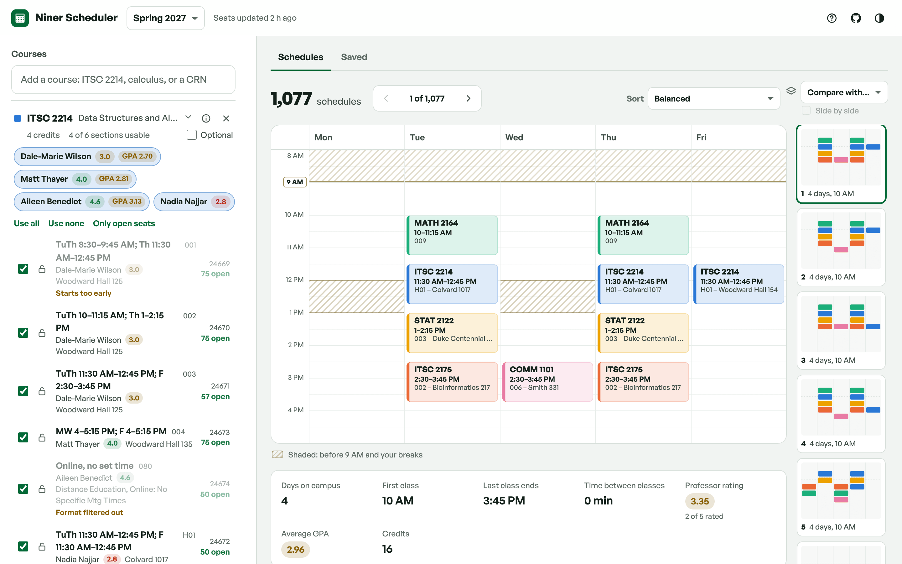
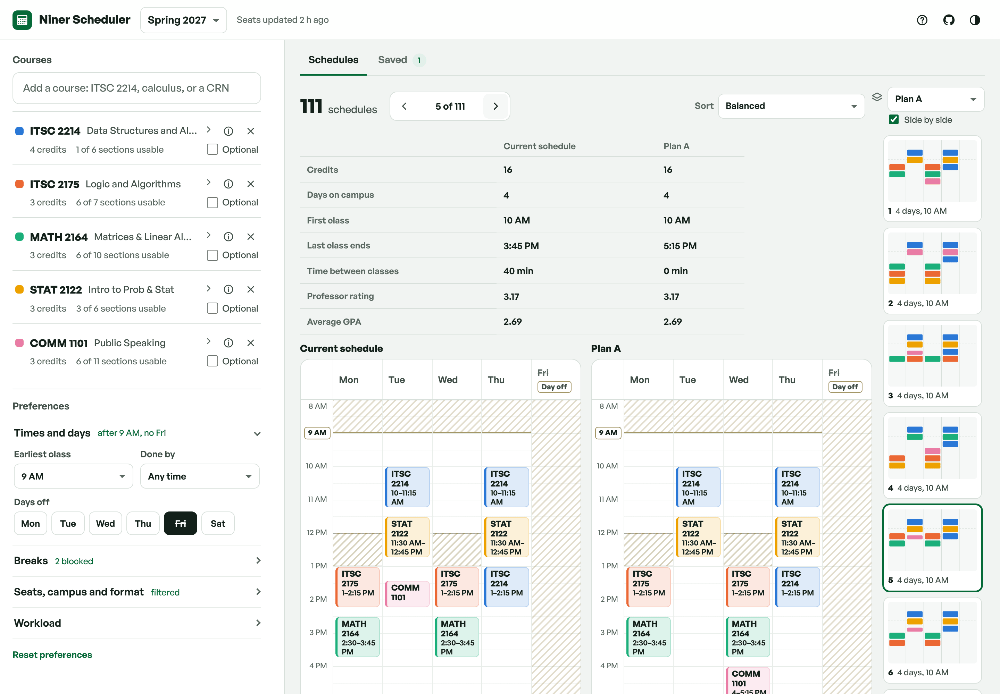
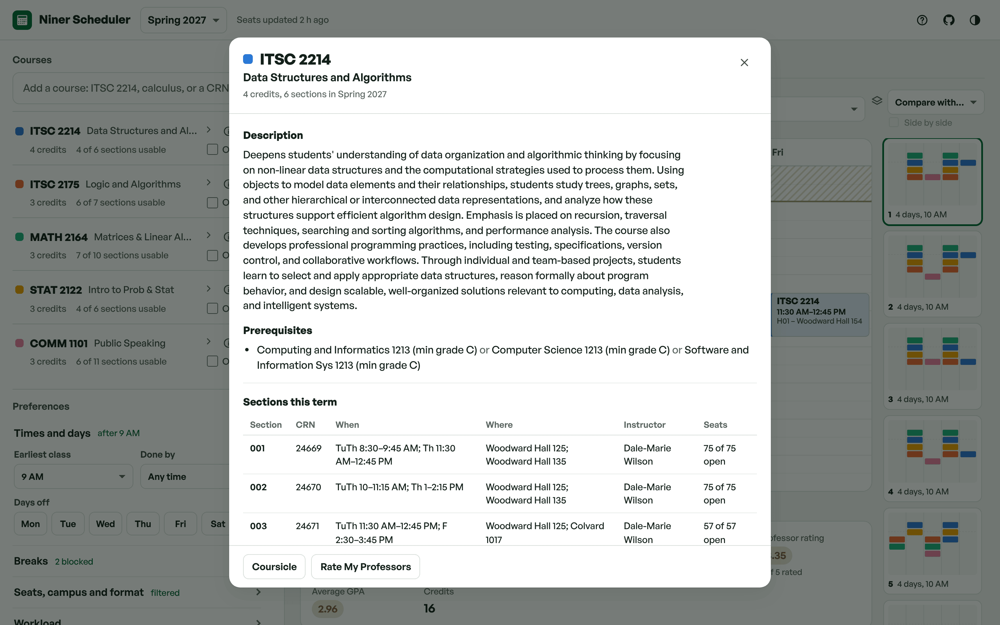
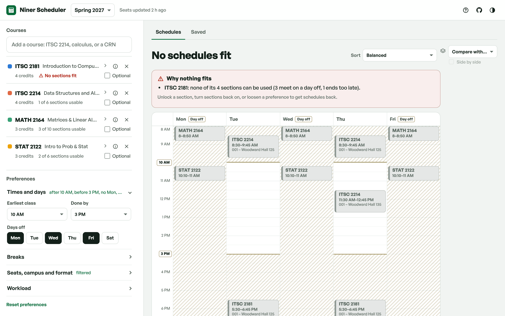
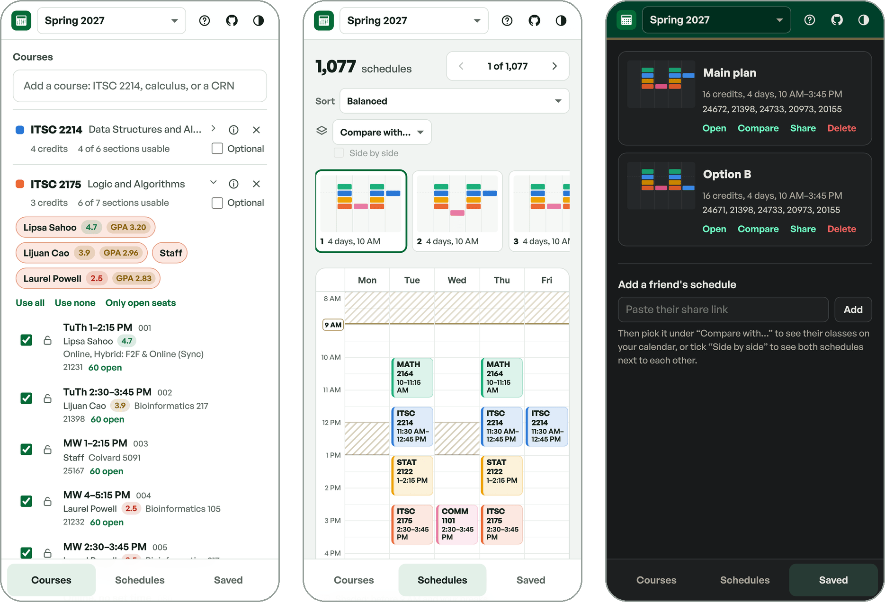

<h1>
  
  Niner Scheduler
</h1>

Build every possible UNC Charlotte class schedule, then narrow it down. Lock the sections you want, turn off professors you don't, block off work or practice time, and compare schedules with Rate My Professors ratings and grade history.

**[Open Niner Scheduler →](https://zagog629.github.io/Niner-Scheduler/)**

<picture>
  <source media="(prefers-color-scheme: dark)" srcset="docs/dark.png">
  
</picture>

## What it does

- **Every schedule, instantly.** Add your courses and every combination without a time conflict shows up. Flip through them with ← and → or pick one from the thumbnail strip.
- **Sort by what matters to you.** Fewest days on campus, least time between classes, start later, finish earlier, best-rated professors, highest average GPA, or a balance of all of them.
- **Narrow it down.** Lock a section, untick sections or whole professors, set days off, earliest and latest times, campus, format and open seats only. Drag on the calendar to block off time.
- **Professor ratings and grade history** next to every instructor, from Rate My Professors and UNC Charlotte's Office of the Registrar.
- **Linked sections and 8-week courses.** Lectures that need a lab or recitation are paired using Banner's link groups, and first-half/second-half sections at the same hour don't count as a conflict.
- **Optional courses and credit ranges.** Mark extras optional and set a credit range to see only the combinations that fit.
- **Save, share and compare.** Save schedules, share a link, overlay a friend's schedule, or view two side by side. Opening a saved schedule loads its courses back into your plan.
- **Why nothing fits.** When no schedule works, the board tells you which course or pair of courses is the problem.
- **Register.** Copy the CRNs into Banner's "Enter CRNs" tab, download an `.ics` file for your calendar, or print a one-page sheet.
- **Private by default.** No accounts, cookies, analytics or ads. Your plan and saved schedules stay in your browser.

## Screenshots

**Compare two schedules side by side**



**Course details, ratings and grade history**



**When nothing fits, it says why**



**On your phone**



## How it works

The site is plain HTML, CSS and JavaScript with no build step and no runtime dependencies. Everything it shows comes from static JSON files:

| File | What's in it | Where it comes from |
| --- | --- | --- |
| `data/terms.json` | Terms open for registration | `scripts/scrape-banner.mjs` |
| `data/terms/<code>.json` | Every section in a term: times, rooms, instructors, seats, link groups | `scripts/scrape-banner.mjs` |
| `data/catalog/<SUBJ>.json` | Course descriptions and prerequisites | `scripts/scrape-banner.mjs` |
| `data/rmp.json` | Rate My Professors summaries for UNC Charlotte instructors | `scripts/scrape-rmp.mjs` |
| `data/grades/<SUBJ>.json` | Grade distributions per course and instructor | `scripts/build-grades.mjs` (checked in) |

The **Update course data** GitHub Action (`.github/workflows/update-data.yml`) runs every two hours. It scrapes UNC Charlotte's public Banner class search (no login needed) and Rate My Professors, then publishes the site and the fresh data to GitHub Pages. Scraped data is never committed: it lives in the Pages deployment and the Actions cache, so if a scrape fails the last good copy is published instead. Only the grade history in `data/grades/` is checked in.

Schedules are generated in a Web Worker (`js/worker.js` → `js/engine.js`) with a depth-first search that prunes conflicts as it goes. Past 20,000 results it keeps the best 2,000 for each sort, so every sort order stays exact.

## Run it locally

You need Node.js 20 or newer. There are no packages to install.

```sh
# Scrape course data (every term open for registration, plus ratings)
npm run scrape

# Or, for a quick partial run while testing
TERMS=202710 SUBJECTS=ITSC,MATH,STAT npm run scrape:banner
npm run scrape:rmp

# Serve the site at http://localhost:8080
npm run dev

# Run the tests
npm test
```

Useful scraper settings:

| Variable | Default | What it does |
| --- | --- | --- |
| `TERMS` | every open term | Term codes to scrape, comma separated (`202710` is Spring 2027) |
| `SUBJECTS` | all | Only scrape these subjects |
| `CONCURRENCY` | `4` | Parallel Banner sessions |
| `CATALOG_MAX_AGE_DAYS` | `30` | Re-download course descriptions older than this |
| `SKIP_CATALOG`, `SKIP_LINKS` | off | Set to `1` to skip descriptions or link groups |
| `RMP_MODE` | `auto` | `names` skips the bulk Rate My Professors listing |

To refresh grade history from a new registrar export, run `npm run grades -- path/to/grades.json`.

## Deploy your own copy

1. Fork the repo.
2. In **Settings → Pages**, set **Source** to **GitHub Actions**.
3. In the **Actions** tab, open **Update course data** and click **Run workflow**. The first run takes a few minutes; after that it refreshes every two hours and on every push to `main`.

## Project layout

```
index.html, privacy.html, 404.html   pages
css/styles.css                       all styles (light and dark themes, print sheet)
js/app.js                            UI: plan panel, board, saved schedules, sharing
js/engine.js                         schedule generation, filters, sorting, metrics
js/grid.js                           weekly calendar, break drawing, thumbnails
js/modal.js                          course details dialog and grade chart
js/data.js, js/names.js              data loading, RMP and grade name matching
js/ics.js                            calendar file export
scripts/                             scrapers, grade builder, dev server
tests/engine.test.mjs                engine and scraper parsing tests
docs/                                README screenshots
```

## Privacy

There are no accounts, cookies, analytics or ads, and no third-party scripts or fonts. Courses, preferences and saved schedules are stored in your browser's local storage and never leave your device. Share links keep the schedule after the `#`, which browsers don't send to the server. See [privacy.html](privacy.html) for the full policy.

## License

MIT. See [LICENSE](LICENSE).

---

Niner Scheduler is an independent project for UNC Charlotte students. It is not affiliated with or endorsed by UNC Charlotte.
